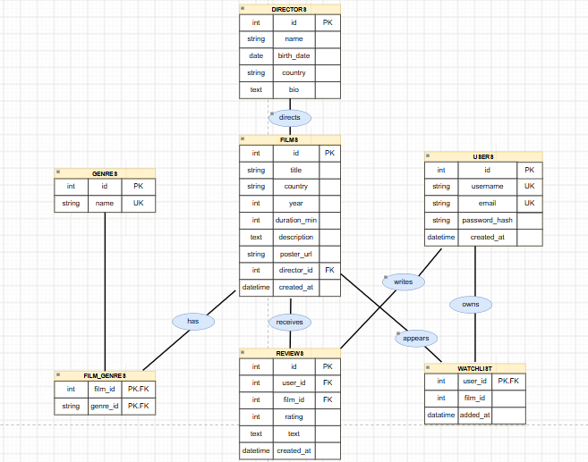

# MovieGuide

## Опис проєкту

**MovieGuide** — інтерактивна вебплатформа для любителів кіно, яка надає можливість переглядати каталог фільмів, отримувати інформацію про режисерів і жанри, а також керувати власними записами про фільми.

Проєкт реалізований на Django та Django REST Framework. Для авторизації користувачів використовується JWT (JSON Web Token).

### Основні можливості

- перегляд каталогу фільмів;
- перегляд детальної інформації про фільми;
- перегляд популярних фільмів;
- перегляд режисерів та інформації про них;
- перегляд жанрів і фільмів певного жанру;
- створення, редагування та видалення записів відповідно до прав доступу;
- реєстрація користувачів;
- авторизація за допомогою JWT;
- оновлення access token за допомогою refresh token;
- вихід із системи з блокуванням refresh token.

---

## Запуск проєкту

### 1. Клонування репозиторію

```bash
git clone https://github.com/katyamarkovska42-code/movie.git
cd movie
```

### 2. Створення віртуального середовища

```bash
python -m venv .venv
```

### 3. Активація віртуального середовища

Windows PowerShell:

```powershell
.venv\Scripts\Activate.ps1
```

### 4. Встановлення залежностей

```bash
pip install -r requirements.txt
```

### 5. Виконання міграцій

```bash
python manage.py migrate
```

### 6. Запуск сервера

```bash
python manage.py runserver
```

API буде доступне за адресою:

`http://127.0.0.1:8000/api/`

---

## Архітектура REST API

Усі запити та відповіді передаються у форматі JSON.

Базовий префікс API:

`/api/`

### 1. Фільми

| Метод | Endpoint | Опис |
|---|---|---|
| GET | `/api/movies/` | Отримати список фільмів |
| POST | `/api/movies/` | Створити новий фільм |
| GET | `/api/movies/{id}/` | Отримати інформацію про фільм |
| PUT | `/api/movies/{id}/` | Оновити фільм |
| DELETE | `/api/movies/{id}/` | Видалити фільм |
| GET | `/api/movies/popular/` | Отримати популярні фільми |

**Поля фільму:**

| Поле | Опис |
|---|---|
| id | Ідентифікатор |
| title | Назва |
| description | Опис |
| year | Рік виходу |
| duration_min | Тривалість у хвилинах |
| country | Країна |
| rating | Рейтинг |
| director | ID режисера |
| director_name | Ім'я режисера (тільки для читання) |
| genres | Список ID жанрів |
| genre_names | Назви жанрів (тільки для читання) |

**Приклад створення фільму:**

```json
{
    "title": "Inception",
    "description": "A science fiction film.",
    "year": 2010,
    "duration_min": 148,
    "country": "USA",
    "rating": 8.8,
    "director": 1,
    "genres": [1, 2]
}
```

Успішна відповідь: `201 Created`.

Для створення фільму потрібна авторизація.

### 2. Режисери

| Метод | Endpoint | Опис |
|---|---|---|
| GET | `/api/directors/` | Отримати список режисерів |
| POST | `/api/directors/` | Створити режисера |
| GET | `/api/directors/{id}/` | Отримати інформацію про режисера |
| PUT | `/api/directors/{id}/` | Оновити інформацію про режисера |
| DELETE | `/api/directors/{id}/` | Видалити режисера |

**Поля режисера:**

- `id` — ідентифікатор;
- `name` — ім'я;
- `bio` — біографія;
- `birth_date` — дата народження;
- `country` — країна.

**Приклад створення режисера:**

```json
{
    "name": "Steven Spielberg",
    "bio": "American film director.",
    "birth_date": "1946-12-18",
    "country": "United States"
}
```

Успішна відповідь: `201 Created`.

Для створення, редагування та видалення потрібна авторизація.

### 3. Жанри

| Метод | Endpoint | Опис |
|---|---|---|
| GET | `/api/genres/` | Отримати список жанрів |
| POST | `/api/genres/` | Створити жанр |
| GET | `/api/genres/{id}/` | Отримати інформацію про жанр |
| PUT | `/api/genres/{id}/` | Оновити жанр |
| DELETE | `/api/genres/{id}/` | Видалити жанр |
| GET | `/api/genres/{id}/movies/` | Отримати фільми певного жанру |

**Поля жанру:**

- `id` — ідентифікатор;
- `name` — назва жанру.

**Приклад створення жанру:**

```json
{
    "name": "Science Fiction"
}
```

Успішна відповідь: `201 Created`.

Для створення, редагування та видалення потрібна авторизація.

---

## 4. Реєстрація та авторизація користувачів

Для роботи з користувачами створено окремий Django app `users`.

Для авторизації використовується JWT.

### 4.1. Реєстрація

**POST** `/api/auth/register/`

Реєстрація нового користувача.

Поля запиту:

| Поле | Обов'язкове |
|---|---|
| username | Так |
| email | Так |
| password | Так |
| password_confirm | Так |
| first_name | Ні |
| last_name | Ні |

Пароль повинен містити щонайменше 8 символів і проходити налаштовані перевірки Django.

**Приклад запиту:**

```json
{
    "username": "movie_fan",
    "email": "user@example.com",
    "first_name": "Alex",
    "last_name": "Smith",
    "password": "StrongPassword123!",
    "password_confirm": "StrongPassword123!"
}
```

Успішна відповідь: `201 Created`.

Пароль зберігається в базі даних у хешованому вигляді.

### 4.2. Вхід

**POST** `/api/auth/login/`

Авторизація користувача за допомогою username та password.

**Приклад запиту:**

```json
{
    "username": "movie_fan",
    "password": "StrongPassword123!"
}
```

Успішна відповідь: `200 OK`.

**Приклад відповіді:**

```json
{
    "refresh": "REFRESH_TOKEN",
    "access": "ACCESS_TOKEN"
}
```

### 4.3. Оновлення access token

**POST** `/api/auth/refresh/`

Використовується для отримання нового access token, коли термін дії попереднього завершився.

**Приклад запиту:**

```json
{
    "refresh": "REFRESH_TOKEN"
}
```

Успішна відповідь: `200 OK`.

У відповідь повертається новий access token. Оскільки налаштовано ротацію refresh token, відповідь також містить новий refresh token. Клієнт повинен зберегти обидва нові токени.

### 4.4. Вихід

**POST** `/api/auth/logout/`

Вихід авторизованого користувача із системи.

Потрібно передати access token у заголовку та refresh token у тілі запиту.

**Headers:**

```http
Authorization: Bearer ACCESS_TOKEN
Content-Type: application/json
```

**Request Body:**

```json
{
    "refresh": "REFRESH_TOKEN"
}
```

Успішна відповідь: `205 Reset Content`.

Refresh token додається до blacklist і більше не може використовуватися для оновлення access token.

Клієнт також повинен видалити збережені токени.

---

## 5. Авторизація та права доступу

Для захищених запитів використовується заголовок:

```http
Authorization: Bearer ACCESS_TOKEN
```

Access token має обмежений термін дії. Після його завершення клієнт може отримати новий за допомогою refresh token.

### Матриця доступу

| Операція | Неавторизований користувач | Авторизований користувач |
|---|---|---|
| Перегляд фільмів | Дозволено | Дозволено |
| Перегляд режисерів | Дозволено | Дозволено |
| Перегляд жанрів | Дозволено | Дозволено |
| Створення фільму | Заборонено | Дозволено |
| Редагування власного фільму | Заборонено | Дозволено |
| Видалення власного фільму | Заборонено | Дозволено |
| Редагування чужого фільму | Заборонено | Заборонено |
| Створення режисера | Заборонено | Дозволено |
| Створення жанру | Заборонено | Дозволено |

Адміністратор із відповідними правами також може редагувати та видаляти чужі фільми.

---

## 6. Обробка помилок

API використовує стандартні HTTP-статуси та власний формат повідомлень про помилки.

| Статус | Код | Опис |
|---|---|---|
| 400 | `validation_error` | Помилка валідації даних |
| 401 | `unauthorized` | Необхідна авторизація |
| 403 | `permission_denied` | Недостатньо прав доступу |
| 404 | `not_found` | Об'єкт не знайдено |
| Інші помилки | `request_error` | Не вдалося виконати запит |

**Приклад відповіді при помилці авторизації:**

```json
{
    "error": {
        "code": "unauthorized",
        "message": "Для виконання цієї дії потрібно увійти в акаунт.",
        "details": {
            "detail": "Authentication credentials were not provided."
        }
    }
}
```

**Приклад помилки валідації:**

```json
{
    "error": {
        "code": "validation_error",
        "message": "Перевірте коректність даних.",
        "details": {
            "title": ["This field is required."]
        }
    }
}
```

---

## 7. Схема бази даних



---

## 8. Тестування API

Для тестування REST API використовується Postman.

Колекція запитів містить перевірки:

- отримання списків і деталей фільмів;
- створення, редагування та видалення фільмів;
- роботи з режисерами та жанрами;
- реєстрації користувача;
- входу та отримання JWT;
- оновлення токенів;
- виходу з акаунта;
- доступу до захищених ендпоінтів;
- перевірки прав власника фільму.

